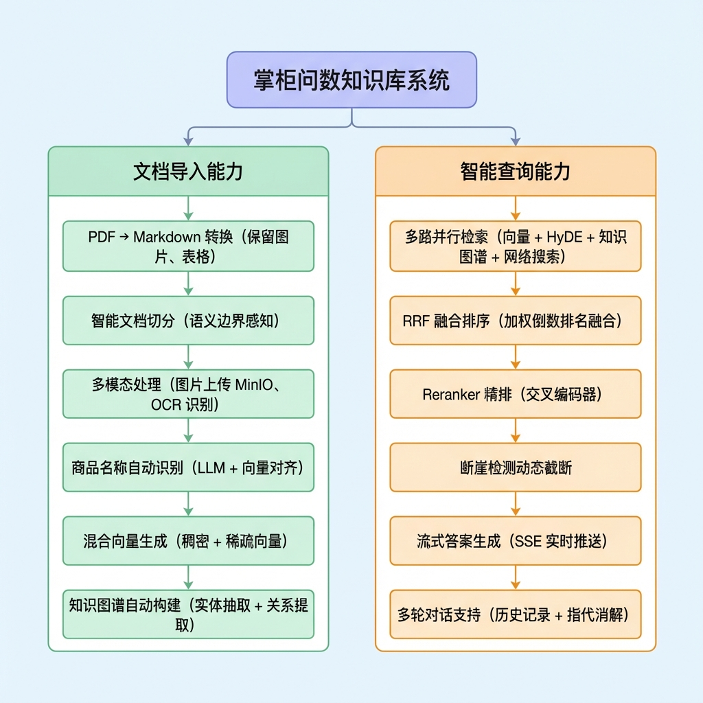
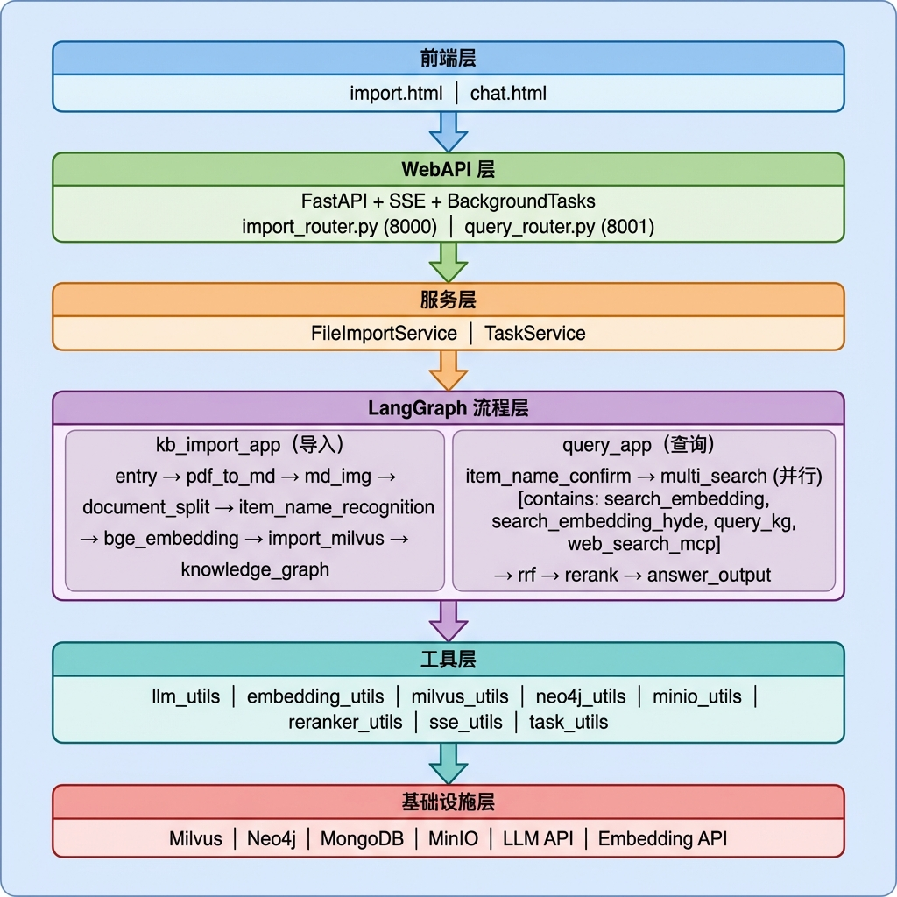
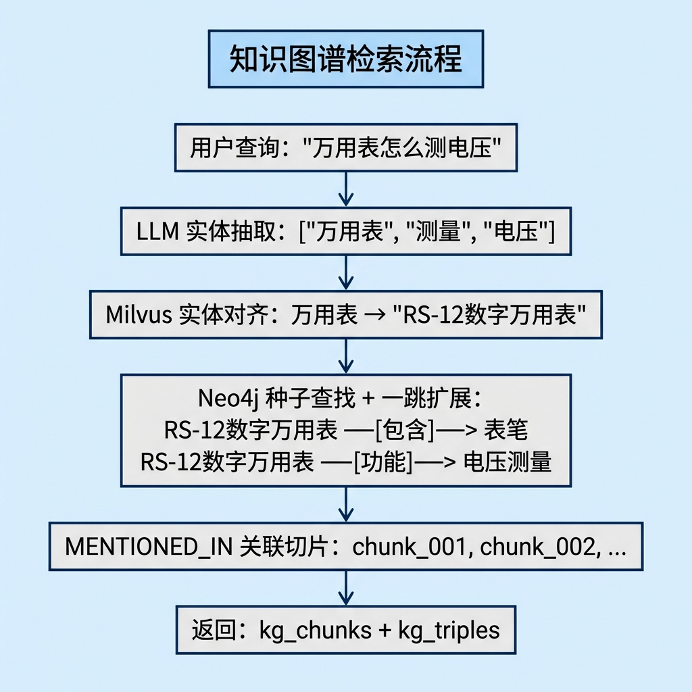
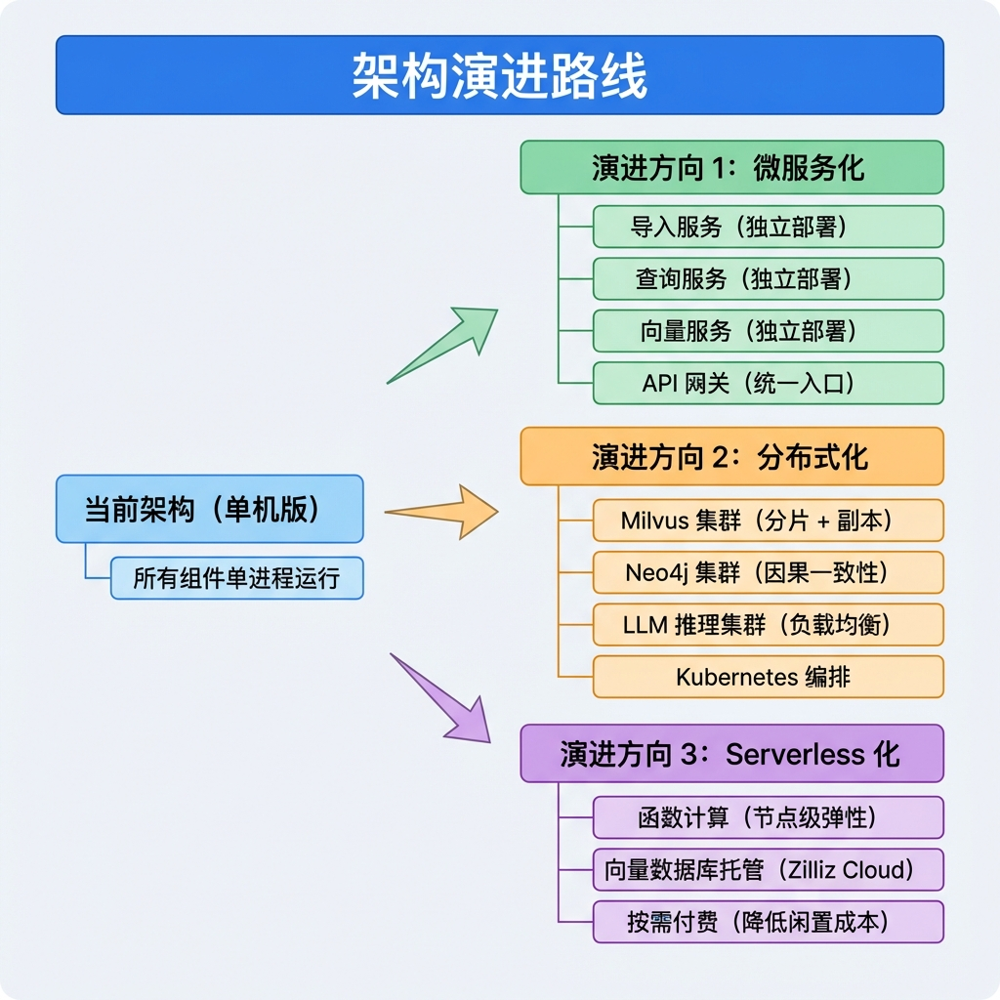
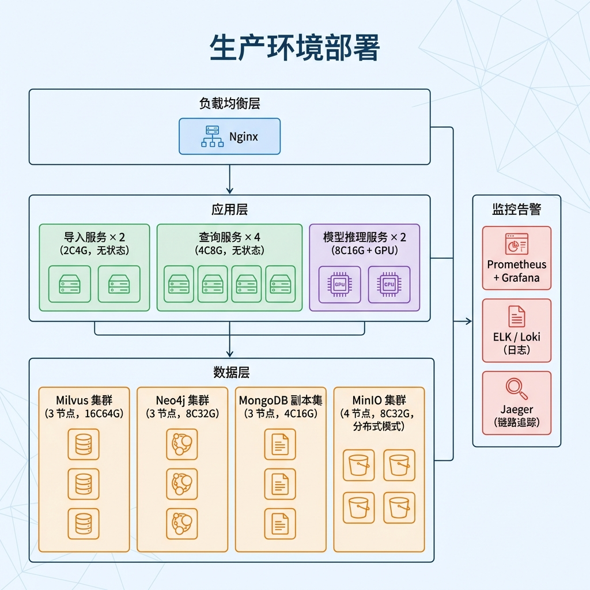

# 21. 项目总结与技术全景

## 1. 项目概述

### 1.1 概览

**掌柜问数知识库系统** 是一个基于 RAG（Retrieval-Augmented Generation）架构的智能问答系统，专为商品知识库场景设计。系统支持 PDF 文档导入、多路检索、知识图谱增强、流式答案生成等功能。

### 1.2 核心能力



### 1.3 系统架构



---

## 2. 第三方中间件与技术栈

### 2.1 核心中间件

| 中间件 | 官网地址 | 作用 | 使用位置 |
|--------|----------|------|----------|
| **Milvus** | https://milvus.io | 向量数据库，存储和检索文档向量 | `milvus_utils.py`、`search_embedding.py`、`import_milvus.py` |
| **Neo4j** | https://neo4j.com | 图数据库，存储知识图谱 | `neo4j_utils.py`、`query_kg.py`、`knowledge_graph.py` |
| **MongoDB** | https://www.mongodb.com | 文档数据库，存储对话历史 | `mongo_history_utils.py`、`answer_output.py` |
| **MinIO** | https://min.io | 对象存储，存储原始文件和图片 | `minio_utils.py`、`md_img.py` |
| **Redis**（可选） | https://redis.io | 缓存和会话存储 | 可用于扩展 |

### 2.2 AI/ML 框架与模型

| 框架/模型 | 官网地址 | 作用 | 使用位置 |
|-----------|----------|------|----------|
| **LangChain** | https://python.langchain.com | LLM 应用框架，统一 LLM 调用接口 | `llm_utils.py`、各 LLM 调用节点 |
| **LangGraph** | https://langchain-ai.github.io/langgraph | 工作流编排框架，构建 DAG 流程 | `main_graph.py`（导入/查询） |
| **BGE-M3** | https://huggingface.co/BAAI/bge-m3 | 混合向量嵌入模型（稠密+稀疏） | `embedding_utils.py`、`bge_embedding.py` |
| **BGE-Reranker** | https://huggingface.co/BAAI/bge-reranker-large | 重排序模型（交叉编码器） | `reranker_utils.py`、`rerank.py` |
| **FlagEmbedding** | https://github.com/FlagOpen/FlagEmbedding | 嵌入模型工具库 | `embedding_utils.py`、`reranker_utils.py` |
| **marker-pdf** | https://github.com/VikParuchuri/marker | PDF 转 Markdown 工具 | `pdf_to_md.py` |

### 2.3 Web 框架与协议

| 框架/协议 | 官网地址 | 作用 | 使用位置 |
|-----------|----------|------|----------|
| **FastAPI** | https://fastapi.tiangolo.com | 高性能 Web 框架 | `import_router.py`、`query_router.py` |
| **Pydantic** | https://docs.pydantic.dev | 数据验证和序列化 | `schemas/`、请求/响应模型 |
| **Uvicorn** | https://www.uvicorn.org | ASGI 服务器 | 应用启动入口 |
| **SSE** | MDN Web Docs | 服务端推送事件协议 | `sse_utils.py`、流式输出 |
| **MCP** | https://modelcontextprotocol.io | 模型上下文协议 | `web_search_mcp.py` |

### 2.4 Python 核心库

| 库 | 官网地址 | 作用 | 使用位置 |
|-----|----------|------|----------|
| **pymilvus** | https://milvus.io/docs | Milvus Python SDK | `milvus_utils.py` |
| **neo4j** | https://neo4j.com/docs/python-manual | Neo4j Python Driver | `neo4j_utils.py` |
| **pymongo** | https://pymongo.readthedocs.io | MongoDB Python Driver | `mongo_history_utils.py` |
| **minio** | https://min.io/docs/minio/linux/developers/python/minio-py.html | MinIO Python SDK | `minio_utils.py` |
| **python-dotenv** | https://github.com/theskumar/python-dotenv | 环境变量管理 | 各模块配置加载 |
| **asyncio** | Python 标准库 | 异步编程支持 | `web_search_mcp.py`、SSE |

---

## 3. 课件结构总览

### 3.1 课件目录

| 编号 | 文档名称 | 主题分类 | 核心内容 |
|------|----------|----------|----------|
| 01 | 项目全景 | 概述 | 系统架构、技术选型 |
| 02 | 环境配置与服务部署指南 | 部署 | Docker、环境变量、服务启动 |
| 03 | 知识库导入骨架代码 | 导入流程 | LangGraph、State、BaseNode |
| 04 | 入口节点与PDF转Markdown | 导入流程 | marker-pdf、文件校验 |
| 05 | 图片处理与MinIO上传 | 导入流程 | MinIO、图片 URL 替换 |
| 06 | 文档切分节点 | 导入流程 | 语义切分、Token 控制 |
| 07 | 商品名识别节点 | 导入流程 | LLM 提取、向量对齐 |
| 08 | 切片向量化节点 | 导入流程 | BGE-M3、混合向量 |
| 09 | 导入向量数据库节点 | 导入流程 | Milvus、批量插入 |
| 10 | 知识图谱构建节点 | 导入流程 | Neo4j、实体关系提取 |
| 11 | 知识库查询骨架代码 | 查询流程 | 查询架构、并行搜索 |
| 12 | 商品名确认节点 | 查询流程 | 指代消解、查询重写 |
| 13 | 向量检索节点 | 查询流程 | Milvus 混合搜索 |
| 14 | HyDE检索节点 | 查询流程 | 假设性文档增强 |
| 15 | 知识图谱查询节点 | 查询流程 | 实体对齐、图遍历 |
| 16 | 网络搜索节点 | 查询流程 | MCP 协议、SSE |
| 17 | RRF融合节点 | 查询流程 | 倒数排名融合 |
| 18 | 重排序节点 | 查询流程 | Reranker、断崖检测 |
| 19 | 答案生成节点 | 查询流程 | 提示词工程、流式输出 |
| 20 | WebAPI层与SSE流式交互 | API层 | FastAPI、事件队列 |
| 21 | 项目总结与技术全景 | 总结 | 技术栈、亮点、优化方向 |

---

## 4. 技术亮点

### 4.1 多路并行检索架构

```
                    multi_search (虚节点)
                          │
        ┌─────────────────┼─────────────────┬─────────────────┐
        │                 │                 │                 │
        v                 v                 v                 v
 search_embedding  search_hyde      query_kg        web_search
   (向量检索)      (HyDE增强)     (知识图谱)       (网络搜索)
        │                 │                 │                 │
        └─────────────────┴─────────────────┴─────────────────┘
                                  │
                                  v
                              RRF 融合
```

**亮点说明：**
- **并行执行**：四路检索同时进行，大幅缩短响应时间
- **互补增强**：不同检索方法覆盖不同场景，提高召回率
- **优雅降级**：单路失败不影响整体流程

### 4.2 混合向量检索

```python
# BGE-M3 生成两种向量
dense_vectors = model.encode(texts)['dense_vecs']   # 768 维稠密向量
sparse_vectors = model.encode(texts)['lexical_weights']  # 稀疏词权重

# Milvus 混合搜索
search_requests = [
    AnnSearchRequest(dense_vectors, "dense_vector", ...),
    AnnSearchRequest(sparse_vectors, "sparse_vector", ...),
]
results = collection.hybrid_search(
    search_requests,
    rerank=WeightedRanker(0.7, 0.3)  # 稠密:稀疏 = 7:3
)
```

**亮点说明：**
- **语义 + 词汇**：稠密向量捕获语义，稀疏向量保留关键词匹配
- **单模型双输出**：BGE-M3 一次编码生成两种向量
- **加权融合**：可配置的权重平衡两种检索能力

### 4.3 知识图谱增强检索



**亮点说明：**
- **实体对齐**：模糊查询精确匹配到图谱实体
- **图谱遍历**：一跳扩展获取关联知识
- **三元组增强**：为 LLM 提供结构化知识

### 4.4 HyDE 假设性文档增强


**亮点说明：**
- **查询扩展**：短查询扩展为完整答案形式
- **语义桥接**：缩小查询与文档的语义鸿沟
- **召回提升**：补充向量检索遗漏的文档

### 4.5 断崖检测动态 TopK

```
传统固定 TopK 的问题:
  得分: [0.95, 0.92, 0.88, 0.12, 0.08]
  固定 K=5: 全部保留（包含噪音）

断崖检测:
  得分: [0.95, 0.92, 0.88, 0.12, 0.08]
  差值:      0.03   0.04   0.76   0.04
                           ↑
                     断崖！截断
  动态 K=3: 只保留高质量文档
```

**亮点说明：**
- **自适应截断**：根据分数分布自动确定 K 值
- **噪声过滤**：排除低质量文档，提高答案质量
- **双阈值设计**：绝对差值 + 相对比例，适应不同分布

### 4.6 SSE 流式输出


**亮点说明：**
- **实时反馈**：边生成边展示，用户体验好
- **事件驱动**：队列解耦生产者和消费者
- **资源友好**：自动清理队列，避免内存泄漏

---

## 5. 可优化方向

### 5.1 性能优化

| 优化方向 | 现状 | 优化方案 | 预期效果 |
|----------|------|----------|----------|
| **向量缓存** | 每次查询重新编码 | 添加 Redis 向量缓存 | 减少重复编码开销 |
| **批量处理** | 部分节点逐条处理 | 使用批量 API | 提升吞吐量 30%+ |
| **异步 IO** | 部分同步阻塞调用 | 全异步改造 | 提升并发能力 |
| **模型量化** | FP16 推理 | INT8 量化 | 降低显存占用 50% |
| **图谱预热** | 冷启动查询慢 | 热点实体预加载 | 首次查询加速 |

### 5.2 功能增强

| 功能方向 | 现状 | 增强方案 | 业务价值 |
|----------|------|----------|----------|
| **多模态检索** | 仅文本检索 | 图片向量化 + 跨模态检索 | 支持"以图搜文" |
| **增量更新** | 全量重建 | 支持文档增量导入 | 降低更新成本 |
| **权限控制** | 无权限隔离 | 多租户 + 文档级权限 | 企业级部署 |
| **答案评估** | 无质量评估 | 添加答案评分机制 | 持续优化质量 |
| **反馈学习** | 无用户反馈 | 收集点赞/踩 + 微调 | 个性化优化 |

### 5.3 架构演进




---

## 6. 部署架构参考

### 6.1 开发环境

```yaml
# docker-compose.dev.yml
version: '3.8'
services:
  milvus:
    image: milvusdb/milvus:v2.3.0
    ports:
      - "19530:19530"
    volumes:
      - ./volumes/milvus:/var/lib/milvus

  neo4j:
    image: neo4j:5.x
    ports:
      - "7474:7474"
      - "7687:7687"
    environment:
      - NEO4J_AUTH=neo4j/password

  mongodb:
    image: mongo:6.0
    ports:
      - "27017:27017"

  minio:
    image: minio/minio:latest
    ports:
      - "9000:9000"
      - "9001:9001"
    command: server /data --console-address ":9001"
```

### 6.2 生产环境建议



---

## 7. 常见问题与解决方案

### 7.1 性能问题

| 问题 | 可能原因 | 解决方案 |
|------|----------|----------|
| 向量检索慢 | 索引未优化 | 调整 HNSW 参数（M, efConstruction） |
| LLM 响应慢 | 模型较大 | 使用更小模型或量化版本 |
| 图谱查询慢 | 缺少索引 | 为 name 属性创建索引 |
| 内存溢出 | 批量过大 | 分批处理，限制单批大小 |

### 7.2 质量问题

| 问题 | 可能原因 | 解决方案 |
|------|----------|----------|
| 召回率低 | 向量模型不匹配 | 使用领域微调模型 |
| 排序不准 | Reranker 效果差 | 更换或微调 Reranker |
| 答案不相关 | 上下文噪声多 | 调整断崖阈值，减少 TopK |
| 图谱信息缺失 | 实体对齐失败 | 降低对齐阈值，增加候选数 |

### 7.3 稳定性问题

| 问题 | 可能原因 | 解决方案 |
|------|----------|----------|
| 连接超时 | 网络不稳定 | 添加重试机制和连接池 |
| 服务崩溃 | 异常未捕获 | 完善异常处理，添加健康检查 |
| 数据不一致 | 并发写入 | 使用分布式锁或事务 |

---

## 8. 总结

### 8.1 技术选型总结

本项目采用了**成熟稳定**的技术栈：
- **LangGraph**：灵活的工作流编排，支持并行和条件分支
- **Milvus**：高性能向量检索，支持混合搜索
- **Neo4j**：成熟的图数据库，丰富的查询能力
- **FastAPI**：现代 Python Web 框架，原生异步支持
- **BGE 系列模型**：开源中文语义理解模型，效果优秀

### 8.2 架构设计总结

- **分层架构**：API → 服务 → 流程 → 工具 → 基础设施
- **节点化设计**：每个处理步骤独立封装，易于测试和维护
- **并行处理**：多路检索并行执行，缩短响应时间
- **流式输出**：SSE 实时推送，提升用户体验
- **容错设计**：单点失败不影响整体流程

### 8.3 课件说明

本系列课件（共 21 篇）完整覆盖了：
- 从零搭建 RAG 知识库系统的全流程
- 每个节点的详细实现步骤和代码
- 核心（RRF、HyDE、断崖检测）讲解
- 生产级的 Web API 和流式交互实现


